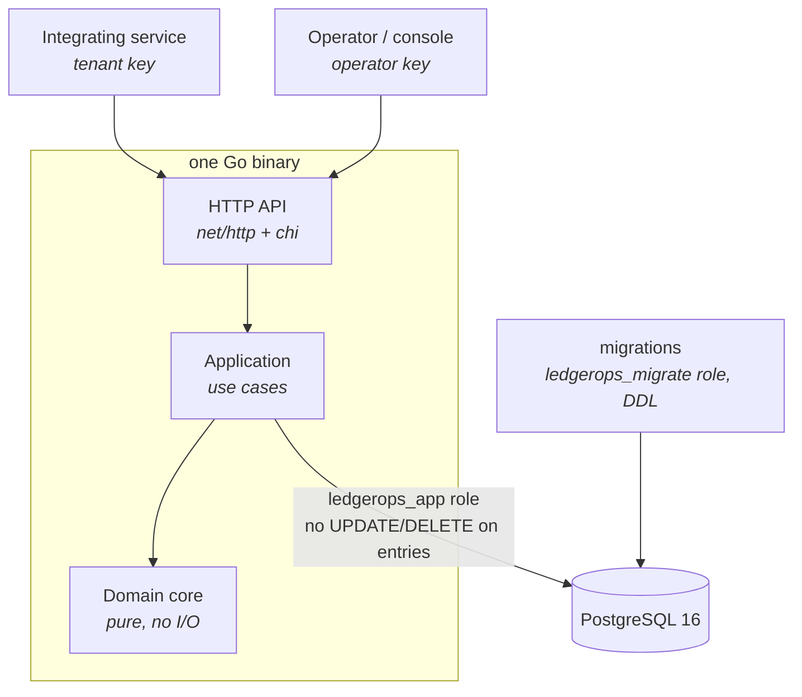

# ledgerops

[](https://github.com/gizawNahom/ledgerops/actions/workflows/ci.yml)

A double-entry ledger service that moves value between accounts correctly, and
can prove it did. Go · PostgreSQL 16 · TypeScript operator console.

> **Status:** a working, well-tested demo stack — not a production-hardened
> service. There is no hosted environment, and the product direction has not
> been validated with real users.

## Why

Most teams that need balances start with a `balance` column and two `UPDATE`
statements. That works until it doesn't, and when it fails it fails silently:
value is created or destroyed, and nobody can reconstruct what happened.
ledgerops is the primitive you reach for before that happens — for digital
wallets, marketplaces, credits and loyalty points. Value is generic: the
ledger doesn't care what a unit represents, only that units are conserved.

More in [`docs/product/vision.md`](docs/product/vision.md).

## What it guarantees

- **Conservation** — every transaction's legs sum to zero, in integer minor
  units, decided by a pure domain core. `GET /health/trial-balance` proves the
  books balance on demand. ([ADR-001](docs/product/architecture/adr-001-signed-int64-minor-units.md), [ADR-007](docs/product/architecture/adr-007-functional-domain-core.md))
- **No overdrafts, even under concurrency** — sufficient funds is checked
  under row locks taken in a deterministic order. ([ADR-002](docs/product/architecture/adr-002-row-locks-for-sufficient-funds.md))
- **History can't be rewritten** — the service's database role has `UPDATE`
  and `DELETE` on entries revoked, and a trigger refuses them as a second
  layer. ([ADR-004](docs/product/architecture/adr-004-append-only-entries.md))
- **Safe retries** — resubmitting with the same `Idempotency-Key` returns the
  original transaction instead of posting twice. ([ADR-005](docs/product/architecture/adr-005-idempotency-replay.md))
- **Tenant isolation** — each tenant's key sees only its own accounts and
  entries. ([ADR-011](docs/product/architecture/adr-011-tenant-partition-not-context.md), [ADR-012](docs/product/architecture/adr-012-tenant-credential-mechanism.md), [ADR-013](docs/product/architecture/adr-013-multitenancy-migration-shape.md))
- **Cross-tenant transfers need both sides** — an operator-authorized tenant
  link plus a registered counterparty alias, and only the two parties (or the
  operator) can read the transfer. ([ADR-014](docs/product/architecture/adr-014-tenant-link-and-counterparty-alias.md), [ADR-015](docs/product/architecture/adr-015-transfer-coordinator-persistence-and-execution.md), [ADR-016](docs/product/architecture/adr-016-dual-party-transfer-authorization.md))

## What it is not

- **Not an accounting package** — no chart-of-accounts templates, tax
  reporting or invoicing.
- **Not a payments processor** — it records movement; it never touches real
  payment rails.
- **Not a hosted service** — you run it yourself.

## Quickstart

**Prerequisites:** Docker with Compose, and `curl`. Go 1.25 and Node 20+ are
only needed for development (see [Development](#development)).

```bash
make up          # builds and starts postgres, migrations, the API on :8080
make demo-01     # posts a transfer end to end — CI runs this on every push
```

Or do it by hand. The demo stack ships with an operator key; provisioning a
tenant returns that tenant's own key:

```bash
API=http://localhost:8080
OP="Authorization: Bearer demo-operator-key"

# 1. Provision a tenant (operator key) and keep its tenant_key
TENANT="Authorization: Bearer $(curl -s -X POST $API/tenants -H "$OP" \
  -H 'Content-Type: application/json' -d '{"name":"acme"}' \
  | grep -o '"tenant_key":"[^"]*"' | cut -d'"' -f4)"

# 2. Open accounts (tenant key). There is no "mint" endpoint: value enters
#    through a system account, which may go negative.
for acct in '"treasury","type":"system"' '"alice","type":"wallet"' '"bob","type":"wallet"'; do
  curl -s -X POST $API/accounts -H "$TENANT" \
    -H 'Content-Type: application/json' -d "{\"account_id\":$acct}"; echo
done

# 3. Fund alice, then move 30.00 to bob
curl -s -X POST $API/transfers -H "$TENANT" -H 'Idempotency-Key: fund-alice' \
  -H 'Content-Type: application/json' -d '{"from":"treasury","to":"alice","amount":"100.00"}'
curl -s -X POST $API/transfers -H "$TENANT" -H 'Idempotency-Key: alice-pays-bob' \
  -H 'Content-Type: application/json' -d '{"from":"alice","to":"bob","amount":"30.00"}'
# → 201 {"legs":[{"account":"alice","amount":"-30.00"},{"account":"bob","amount":"30.00"}],"transaction_id":"txn_…"}
```

Then try the guarantees:

```bash
# Retry with the same key: 200, same transaction_id, nothing posted twice
curl -s -X POST $API/transfers -H "$TENANT" -H 'Idempotency-Key: alice-pays-bob' \
  -H 'Content-Type: application/json' -d '{"from":"alice","to":"bob","amount":"30.00"}'

# Overdraw: 422 {"account_id":"alice","available":"70.00","error":"insufficient_funds","requested":"500.00"}
curl -s -X POST $API/transfers -H "$TENANT" -H 'Idempotency-Key: alice-overdraws' \
  -H 'Content-Type: application/json' -d '{"from":"alice","to":"bob","amount":"500.00"}'

# Balance and the entries behind it, with running balances
curl -s $API/accounts/alice -H "$TENANT"          # {"account_id":"alice","balance":"70.00","type":"wallet"}
curl -s $API/accounts/alice/entries -H "$TENANT"

# Prove the books balance (operator key)
curl -s $API/health/trial-balance -H "$OP"        # {"verdict":"Books balance: YES","imbalance_minor":0,…}
```

`make down` stops the stack **and deletes its data volume**. The keys and
database passwords in `docker-compose.yml` are local demo values — don't reuse
them anywhere real.

## Proof

| Command | What it shows | Needs |
|---|---|---|
| `make demo-01` | A transfer posts as two balanced legs | Docker, curl |
| `make demo-02` | Overdraft refused with `422`, naming the shortfall | Docker, curl |
| `make demo-03` | A retried request returns the same transaction | Docker, curl |
| `make demo-04` | A fresh tenant goes from provisioned to first transfer | Docker, curl |
| `make chaos-01` | `SIGKILL` the API mid-write; the retry lands exactly once | Docker, curl |
| `make race-02` | No balance goes negative under concurrent spenders | Docker, Go |
| `make race-03` | Concurrent duplicate submissions store one transaction | Docker, Go |

`demo-04` (like the quickstart above) provisions a fixed tenant name, so a
second run fails with `tenant_already_exists`; run `make down` first. In [CI](.github/workflows/ci.yml), the race checks and the
append-only and multitenancy acceptance suites gate the build, and the demos
run from a clean checkout on every push. Timing targets are reported, not
enforced; [`kpi-contracts.yaml`](docs/product/kpi-contracts.yaml) says which is
which.

## Operator console and observability

The console shows the trial-balance verdict, any drifted accounts, and a
drill-down into each account's entries. Run it with the Vite dev server
against the running stack:

```bash
cd web/console && npm ci && npm run dev   # open the URL it prints, paste demo-operator-key
```

The compose stack also starts Prometheus on `:9090` and Grafana on `:3000`.
`GET /metrics` is unauthenticated by design, so scrapers don't need a key.

## API

| Route | Credential |
|---|---|
| `POST /tenants` | operator |
| `POST /tenant-links`, `DELETE /tenant-links/{link_id}` | operator |
| `GET /health/trial-balance`, `GET /console/verdict` | operator |
| `POST /accounts`, `GET /accounts/{id}` | tenant |
| `POST /transfers` (a `counterparty_alias` body sends cross-tenant) | tenant |
| `POST /counterparties` | tenant |
| `GET /accounts/{id}/entries` | tenant, or operator (all tenants) |
| `GET /transfers/{transfer_id}` | either party's tenant key, or operator |
| `GET /metrics`, `GET /console/*` | none |

Credentials are `Authorization: Bearer <key>`. The operator key is never
accepted on tenant routes; a wrong or missing key gets
`401 {"error":"unidentified_caller"}`. Routes are wired in
[`internal/adapters/http/router.go`](internal/adapters/http/router.go).

## Architecture



A modular monolith with ports and adapters: a pure functional domain core
decides, and the shell around it performs the effects. The service never
connects as the migration role, so it can't disable the append-only trigger.
Migrations are expand-only, so rolling back code never needs a schema
rollback. The full design is in
[`docs/product/architecture/brief.md`](docs/product/architecture/brief.md) and
the [ADRs](docs/product/architecture/).

## Development

```
cmd/api/              entrypoint
internal/domain/      pure domain core (no I/O)
internal/app/         use cases
internal/adapters/    http and postgres adapters
web/console/          operator console (React 18 + Vite)
tests/acceptance/     Gherkin acceptance suites (godog), run against PostgreSQL
scripts/race/         concurrency drivers behind race-02/03
```

Tests, as CI runs them (the acceptance suites start PostgreSQL through
Testcontainers, so they need Docker):

```bash
go test ./internal/domain/... ./internal/app/... -race
go test ./internal/adapters/postgres/... -race
go test ./tests/acceptance/... -count=1
cd web/console && npm run lint && npm test
```

The `internal/adapters/http` tests verify the console's Pact contract and need
the native `libpact_ffi` library; see the `console` job in
[`ci.yml`](.github/workflows/ci.yml) for the install step.

When contributing, keep `internal/domain` pure — effects belong in
`internal/adapters` — and run `gofmt`, since CI rejects unformatted files.

## How it was built

ledgerops was built with the nWave methodology, by AI agents working in Claude Code through discuss, design,
distill (acceptance tests first) and deliver waves. [`CLAUDE.md`](CLAUDE.md)
holds the working conventions. The `docs/feature/` and `docs/evolution/`
directories are the waves' working papers and retrospectives, not user
documentation; the user-facing docs are this README, the
[vision](docs/product/vision.md), the
[architecture brief](docs/product/architecture/brief.md) and the ADRs.
