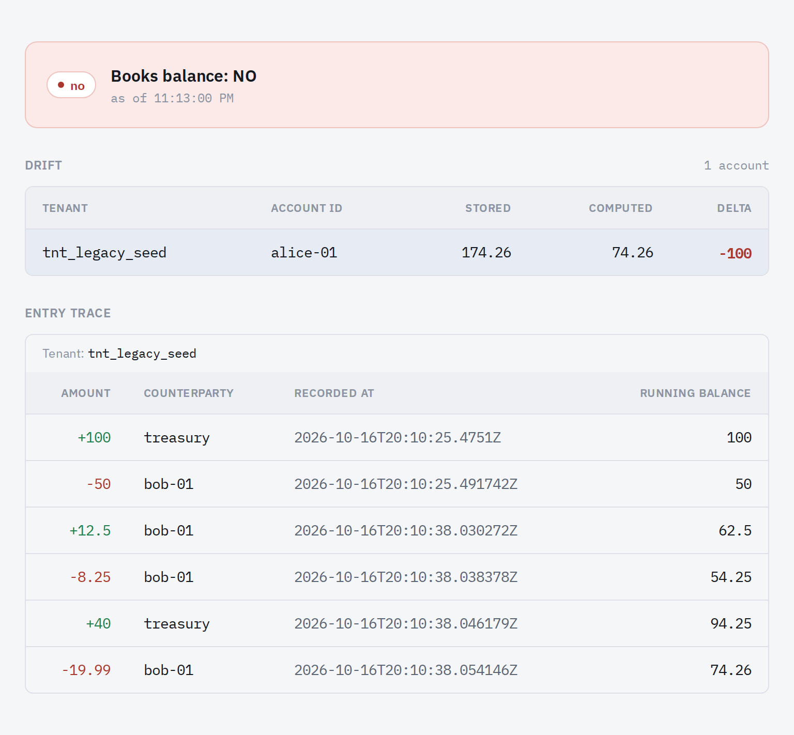
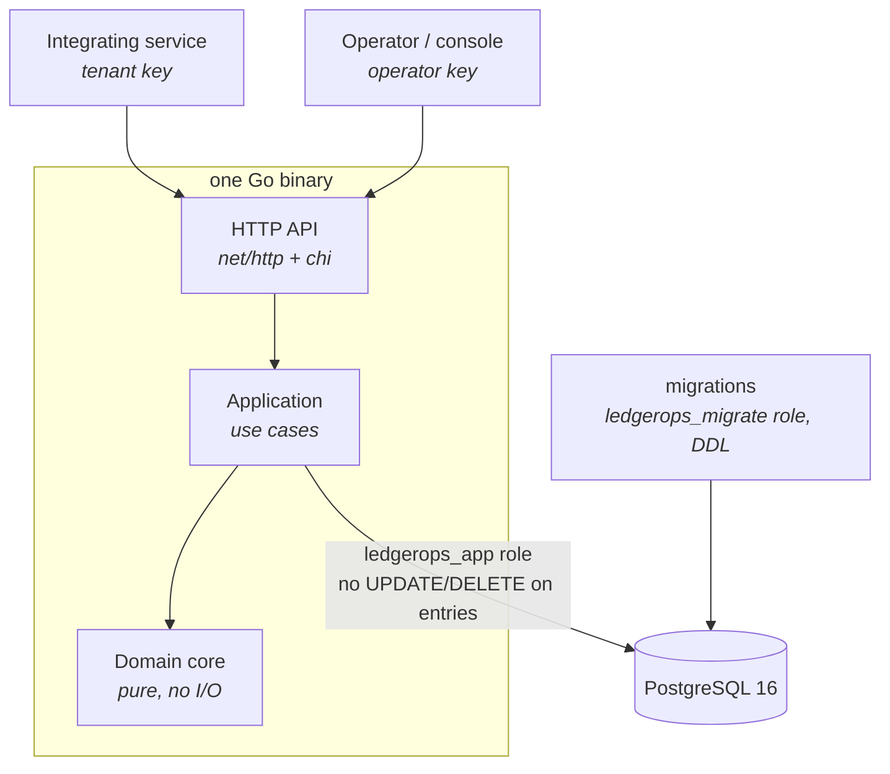

# ledgerops

[](https://github.com/gizawNahom/ledgerops/actions/workflows/ci.yml)

A double-entry ledger service that moves value between accounts correctly, and
can prove it did. Go · PostgreSQL 16 · TypeScript operator console.

> **Status:** the core is complete and covered by property-based, race and
> crash tests, but it isn't production-ready yet. See
> [Status and limitations](#status-and-limitations) and the
> [Roadmap](#roadmap).

**At a glance**

- An HTTP API your services call to open accounts, move value and read
  balances
- No overdrafts, even under concurrent requests; safe retries with
  idempotency keys
- History that can't be rewritten, enforced by database permissions
- Multiple tenants with isolated data
- An on-demand check that the books balance, naming any account that drifts
  ([see it in the console](#operator-console-and-observability))

```text
POST /transfers  {"from":"alice-01","to":"bob-01","amount":"500.00"}
→ 422 {"account_id":"alice-01","available":"50.00","error":"insufficient_funds","requested":"500.00"}

GET /health/trial-balance
→ 200 {"verdict":"Books balance: YES","imbalance_minor":0,"entry_count":4,…}
```

## Why

Most teams that need balances start with a `balance` column and two `UPDATE`
statements. That works until it doesn't, and when it fails it fails silently:
value is created or destroyed, and nobody can reconstruct what happened.
ledgerops does the bookkeeping part correctly from day one — for digital
wallets, marketplaces, credits and loyalty points. The ledger doesn't care
what a unit represents, only that units are conserved. More in
[`docs/product/vision.md`](docs/product/vision.md).

## What it guarantees

- **Conservation** — every transaction's legs sum to zero, in integer minor
  units, decided by a pure domain core. `GET /health/trial-balance` checks
  the whole ledger on demand.
- **No overdrafts, even under concurrency** — sufficient funds is checked
  under row locks taken in a fixed order, so concurrent transfers can't both
  spend the same money.
- **History can't be rewritten** — the service's database role has `UPDATE`
  and `DELETE` on entries revoked, and a trigger refuses them as a second
  layer.
- **Safe retries** — resubmitting with the same `Idempotency-Key` returns the
  original transaction instead of posting twice.
- **Tenant isolation** — each tenant's key sees only its own accounts and
  entries.
- **Cross-tenant transfers need both sides** — an operator-authorized link
  between the two tenants plus a registered counterparty, and only the two
  parties (or the operator) can read the transfer.

The reasoning behind each is in the
[architecture decision records](docs/product/architecture/).

## When to choose ledgerops (and when not to)

Choose ledgerops if you already run PostgreSQL, want the ledger as a separate
service your applications call over HTTP, and care most about being able to
show — to yourself, an auditor or a regulator — that the books balance and
that history hasn't been rewritten.

It is **not** an accounting package (no chart-of-accounts templates, tax
reporting or invoicing), **not** a payments processor (it records movement and
never touches real payment rails), and **not** a hosted service (you run it
yourself).

Other open-source ledgers make different trade-offs, and one of them may suit
you better:

| If you need… | Consider | Why |
|---|---|---|
| Very high throughput | [TigerBeetle](https://github.com/tigerbeetle/tigerbeetle) | A purpose-built financial transactions database with very high throughput; it's a database rather than a service, so you add the API layer |
| Ledger writes in the same database transaction as your application's data | [pgledger](https://github.com/pgr0ss/pgledger) | A ledger made of SQL functions inside your own PostgreSQL, with no separate service |
| Programmable transaction logic and a full fintech platform | [Formance Ledger](https://github.com/formancehq/ledger) | Its own scripting language (Numscript), and runs as a replicated cluster |
| Holds, multi-currency, reconciliation and a hosted option today | [Blnk](https://github.com/blnkfinance/blnk) | The closest in shape to ledgerops (a Go + PostgreSQL service), with a wider feature set today |

_Based on each project's public documentation as of October 2026; check their
current state._

What ledgerops emphasises: a built-in trial-balance verdict with per-account
drift detection, append-only history enforced by database permissions rather
than convention, an operator console for checking the books, and tests that
exercise those guarantees under races and crashes.

## Quickstart

**Prerequisites:** Docker with Compose, and `curl`. Go 1.25 and Node 20+ are
only needed for development (see [Development](#development)).

```bash
make up          # builds and starts the stack: PostgreSQL, migrations, the API on :8080, Prometheus and Grafana
make demo-01     # opens alice-01 and bob-01, funds alice-01 with 100.00, moves 50.00 to bob-01
```

Then try the guarantees with the demo tenant's key:

```bash
API=http://localhost:8080
TENANT="Authorization: Bearer demo-tenant-key"
OP="Authorization: Bearer demo-operator-key"

# Retry demo-01's transfer with the same key: 200, same transaction_id, nothing posted twice
curl -s -X POST $API/transfers -H "$TENANT" -H 'Idempotency-Key: demo-01-transfer' \
  -H 'Content-Type: application/json' -d '{"from":"alice-01","to":"bob-01","amount":"50.00"}'

# Overdraw: 422 {"account_id":"alice-01","available":"50.00","error":"insufficient_funds","requested":"500.00"}
curl -s -X POST $API/transfers -H "$TENANT" -H 'Idempotency-Key: alice-overdraws' \
  -H 'Content-Type: application/json' -d '{"from":"alice-01","to":"bob-01","amount":"500.00"}'

# Balance, and the entries behind it with running balances
curl -s $API/accounts/alice-01 -H "$TENANT"          # {"account_id":"alice-01","balance":"50.00","type":"wallet"}
curl -s $API/accounts/alice-01/entries -H "$TENANT"

# Check the books balance (operator key)
curl -s $API/health/trial-balance -H "$OP"           # {"verdict":"Books balance: YES","imbalance_minor":0,…}
```

To start from nothing instead — provision your own tenant, open accounts and
fund them — follow [`docs/quickstart.md`](docs/quickstart.md).

`make down` stops the stack **and deletes its data volume**. The keys and
database passwords in `docker-compose.yml` are local demo values — don't reuse
them anywhere real.

## Proof

| Command | What it shows | Needs |
|---|---|---|
| `make demo-01` | A transfer posts as two balanced legs | Docker, curl |
| `make demo-02` | Overdraft refused with `422`, naming the shortfall | Docker, curl |
| `make demo-03` | A retried request returns the same transaction | Docker, curl |
| `make demo-04` | A fresh tenant goes from provisioned to first transfer | Docker, curl |
| `make chaos-01` | `SIGKILL` the API mid-write; the retry lands exactly once | Docker, curl |
| `make race-02` | No balance goes negative under concurrent spenders | Docker, Go |
| `make race-03` | Concurrent duplicate submissions store one transaction | Docker, Go |

Beyond these, property-based tests
([`rapid`](https://github.com/flyingmutant/rapid)) check the domain and
use-case rules — conservation, refusals that change nothing, retries that
post once — against randomly generated transfers; CI runs them at 1,000
cases each.

In [CI](.github/workflows/ci.yml), the race checks, the property tests and the
append-only and multitenancy acceptance suites fail the CI run if a guarantee
breaks, and the demos run from a clean checkout on every push. Timing targets
are reported rather than enforced; [`kpi-contracts.yaml`](docs/product/kpi-contracts.yaml)
lists each target and how it's checked. `demo-04` provisions a fixed tenant
name, so a second run fails with `tenant_already_exists`; run `make down`
first.

## Status and limitations

**Supported today**

- Accounts (`wallet` and `system`) and two-leg transfers between them, with
  overdraft protection, idempotent retries and append-only history
- Multiple tenants with isolated data and their own API keys, plus
  dual-authorized transfers between tenants
- On-demand proof that the books balance, with per-account drift detection
- Prometheus metrics, structured JSON request logs, and an operator console
- Expand-only database migrations, so rolling back the service never needs a
  schema rollback

**Not yet**

- **One currency** — the API accepts USD amounts only
- **No holds** — no reserve-then-capture or void flow
- **No transactions with more than two legs** — e.g. paying a seller and a
  platform fee atomically takes two transfers today
- **No metadata on transfers** — no field for your own order or reference ids
- **No webhooks or event stream** — integrations have to poll
- **No OpenAPI spec, client SDKs or versioned releases**, and no published
  container image; you build from source
- **No tenant key rotation** or tenant offboarding
- **No TLS in the service itself** — run it behind a TLS-terminating proxy
- **Not yet run in production**, and not tested with more than one app
  instance
- **Hot-account write contention** — see below

## Performance

**In short:** tested at about 276 requests/s on a small, resource-capped
stack with no errors. Concurrent transfers on the same account queue behind
each other, so a single very busy account — a treasury or fee account, say —
is the first limit you'll hit.

The detail: [`tests/load/transfers.js`](tests/load/transfers.js) drives the
stack with k6 in four profiles — `load`, `stress`, `soak` and `capacity` —
through the manually triggered [Load test](.github/workflows/load-test.yml)
workflow; it never runs on push. `capacity` holds a flat 300 requests/s
against a CPU- and memory-capped stack
([`docker-compose.loadtest.yml`](docker-compose.loadtest.yml)), with 80% of
traffic aimed at 100 "hot" accounts out of 500, and passes only if
throughput, p95 latency (under 500 ms) and errors (under 1%) all hold.

In the last recorded run (2026-09-02), throughput (276.5 req/s) and errors
(0%) held, but p95 latency reached 923 ms. CPU, memory and the connection
pool were each ruled out; during the run, 41–50 PostgreSQL connections sat
waiting on row locks. Every transfer locks its sender and recipient rows
(`SELECT … FOR UPDATE`, the price of the no-overdraft guarantee), so
concurrent transfers touching the same account queue behind each other.
Spreading the hot traffic across more accounts didn't relieve it, and reads
never take these locks. The latency threshold was kept strict rather than
loosened to pass; the fixes are on the [Roadmap](#roadmap). The full
investigation is in the
[load-test notes](docs/feature/ledger-core/feature-delta.md).

## Roadmap

1. **Adoptable** — versioned releases with a published container image, an
   OpenAPI spec, and metadata on transfers.
2. **Wallet essentials** — holds (reserve, capture, void), transactions with
   more than two legs, and webhooks driven by an outbox so only committed
   postings are announced.
3. **Tamper evidence** — hash-chained entries, signed checkpoints, and a
   standalone `ledgerops verify` command an auditor can run against a copy of
   the database without trusting the running service.
4. **Performance** — shorter lock hold times on the write path, then group
   commit for busy accounts.

## Operator console and observability



*Staged for this picture: one stored balance was changed directly in the
database. The console flags the account and traces the entries that give its
true balance.*

The console shows the trial-balance verdict, any drifted accounts, and a
drill-down into each account's entries. Run it with the Vite dev server
against the running stack:

```bash
cd web/console && npm ci && npm run dev   # open the URL it prints, paste demo-operator-key
```

The stack also runs Prometheus on `:9090` and Grafana on `:3000`.
`GET /metrics` is unauthenticated by design, so scrapers don't need a key.

## API

| Route | Credential |
|---|---|
| `POST /tenants` | operator |
| `POST /tenant-links`, `DELETE /tenant-links/{link_id}` | operator |
| `GET /health/trial-balance`, `GET /console/verdict` | operator |
| `POST /accounts`, `GET /accounts/{id}` | tenant |
| `POST /transfers` (a `counterparty_alias` body sends cross-tenant) | tenant |
| `POST /counterparties` | tenant |
| `GET /accounts/{id}/entries` | tenant, or operator (all tenants) |
| `GET /transfers/{transfer_id}` | either party's tenant key, or operator |
| `GET /metrics`, console static assets | none |

Credentials are `Authorization: Bearer <key>`. The operator key is never
accepted on tenant routes; a wrong or missing key gets
`401 {"error":"unidentified_caller"}`. Routes are wired in
[`internal/adapters/http/router.go`](internal/adapters/http/router.go).

## Architecture



A modular monolith with ports and adapters: a pure functional domain core
decides, and the shell around it performs the effects. The service never
connects as the migration role, so it can't disable the append-only trigger.
Migrations are expand-only, so rolling back code never needs a schema
rollback. The full design is in the
[architecture brief](docs/product/architecture/brief.md) and the
[decision records](docs/product/architecture/).

## Development

```
cmd/api/              entrypoint
internal/domain/      pure domain core (no I/O)
internal/app/         use cases
internal/adapters/    http and postgres adapters
web/console/          operator console (React 18 + Vite)
tests/acceptance/     Gherkin acceptance suites (godog), run against PostgreSQL
scripts/race/         concurrency drivers behind race-02/03
```

Tests, as CI runs them (the acceptance suites start PostgreSQL through
Testcontainers, so they need Docker):

```bash
go test ./internal/domain/... ./internal/app/... -race
go test ./internal/adapters/postgres/... -race
go test ./tests/acceptance/... -count=1
cd web/console && npm run lint && npm test
# internal/adapters/http also needs the native libpact_ffi library — see the console job in ci.yml
```

When contributing, keep `internal/domain` pure — effects belong in
`internal/adapters` — and run `gofmt`, since CI rejects unformatted files.

## How it was built

Built with Claude Code agents, following the nWave methodology: acceptance
tests first, then implementation. [`CLAUDE.md`](CLAUDE.md) holds the working
conventions. `docs/feature/` and `docs/evolution/` hold the design and
delivery notes from that process; they're working papers, not user
documentation.

## License

Apache License 2.0. See [`LICENSE`](LICENSE).
